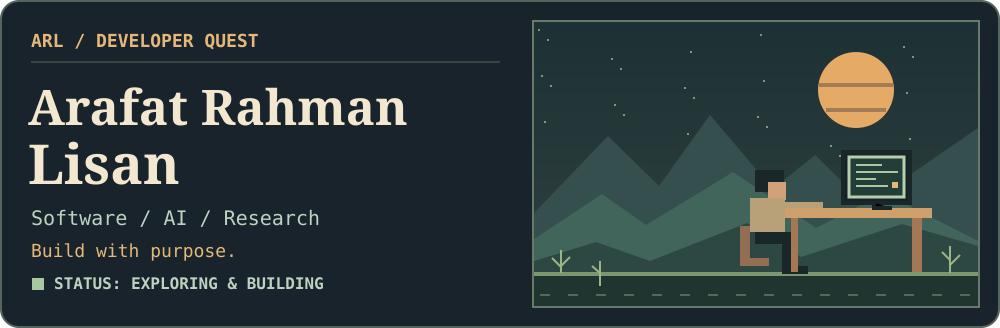
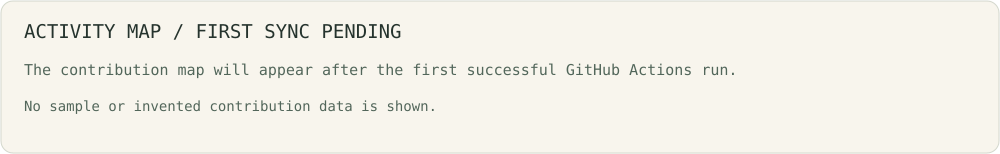

  
  
  

    
    
    
  

### About

I'm a CSE undergraduate at American International University-Bangladesh (AIUB), building software and exploring AI, NLP and intelligent systems.

I enjoy turning ideas into practical tools, experimenting with research and solving problems that matter.

### Technologies

  

**Focus:** Full-stack development · Machine learning · Natural language processing

### Selected work

- [DOXRINE](https://github.com/arafat-rahman-lisan/doxrine-showcase) — business intelligence and automated lead discovery.
- [Emotion-Aware Book Recommendation](https://github.com/arafat-rahman-lisan/Emotion-Aware-Book-Recommendation-System) — NLP and hybrid recommendation research.
- [ENGAGE.](https://github.com/arafat-rahman-lisan/AIUB_English_Club_Volunteers_Portal) — volunteer management and event coordination.
- [ICT Practice AI](https://github.com/arafat-rahman-lisan/ict-mcq-practice) · [Neural Network Lab](https://github.com/arafat-rahman-lisan/neural-network-simulation) — interactive educational tools.

More projects in my [repositories](https://github.com/arafat-rahman-lisan?tab=repositories).

### GitHub activity

  <picture>
    <source media="(prefers-color-scheme: dark)" srcset="assets/github-snake-dark.svg" />
    <source media="(prefers-color-scheme: light)" srcset="assets/github-snake.svg" />
    
  </picture>

  <picture>
    <source media="(prefers-color-scheme: dark)" srcset="assets/activity-dark.svg" />
    
  </picture>

  

