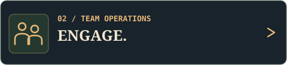
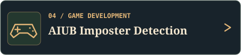
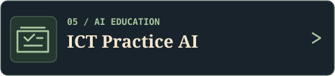

  
  

  

    
    &nbsp;
    
    &nbsp;
    
    &nbsp;
    
    &nbsp;
    
  

## 01 / Player profile

CSE undergraduate at **AIUB**. I build practical software and explore **AI, NLP and intelligent systems**.

**Current quests:** Applied AI · Full-stack engineering · Research

## 02 / Quest log

Selected builds across research, software and interactive experiences.

| **Intelligence & research** | **Software & experiences** |
|:---|:---|
|  Automated business discovery and lead generation. [Live](https://doxrine.com/) |  Volunteer coordination and contribution recognition. |
|  Semantic relevance, emotion and hybrid ranking. |  C++/OpenGL game with a browser edition. [Play](https://arafat-rahman-lisan.github.io/AIUB_Imposter_Detection/) |
|  Bilingual learning with AI explanations. [Try it](https://arafat-rahman-lisan.github.io/ict-mcq-practice/) |  Interactive experiments for deep learning. [Launch](https://arafat-rahman-lisan.github.io/neural-network-simulation/) |

<b>More side quests</b>

- [DSA Fieldnotes](https://github.com/arafat-rahman-lisan/dsa_fieldnotes) — structured algorithm practice and visual traces.
- [Pharmacy Management System](https://github.com/arafat-rahman-lisan/Pharmacy-Management-System) — a software management system.
- [Movie Ticket Management System](https://github.com/arafat-rahman-lisan/MovieTicket-Site-Management-System) — cinema management software.
- [Life Mirror](https://github.com/arafat-rahman-lisan/Life_Mirror) — another experiment in building useful software.

## 03 / Inventory

**Languages** &nbsp; `Python` · `C++` · `JavaScript` · `PHP` · `C#`

**Web & software** &nbsp; `HTML/CSS` · `ASP.NET Core` · `SQLite` · `Git` · `GitHub`

**AI & research** &nbsp; `NLP` · `Transformers` · `Semantic Search` · `Machine Learning`

**Exploring** &nbsp; computer vision, deep learning and intelligent systems.

## 04 / Contribution trail

  <picture>
    <source media="(prefers-color-scheme: dark)" srcset="assets/github-snake-dark.svg" />
    <source media="(prefers-color-scheme: light)" srcset="assets/github-snake.svg" />
    
  </picture>

My real GitHub activity, animated and refreshed daily. [View contribution history](https://github.com/arafat-rahman-lisan#contributions-calendar).

## 05 / Beyond the code

Beyond coding, I coordinate volunteers and event logistics at **AIUB English Club**, combining team leadership with practical technology.

  BUILD · LEARN · ITERATE 
  <b>Always another quest ahead.</b> 
  <a href="https://www.linkedin.com/in/arafat-rahman-lisan/">Connect on LinkedIn</a>

