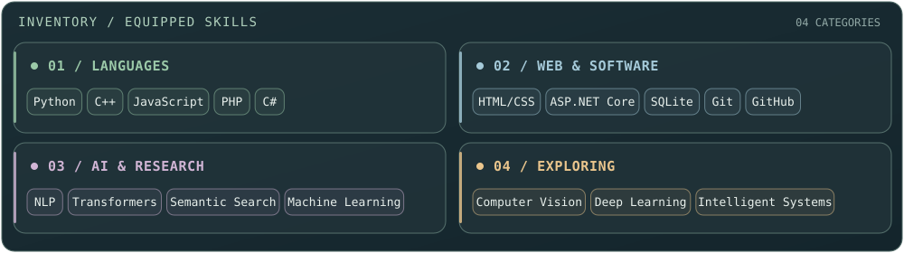
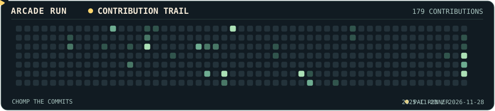

  
  

  

    
    &nbsp;
    
    &nbsp;
    
    &nbsp;
    
    &nbsp;
    
  

## 01 / Player profile

  

## 02 / Quest log

  
  

  
  

  
  

[DOXRINE live](https://doxrine.com/) · [ICT Practice live](https://arafat-rahman-lisan.github.io/ict-mcq-practice/) · [Play Imposter Detection](https://arafat-rahman-lisan.github.io/AIUB_Imposter_Detection/) · [Neural Network Lab live](https://arafat-rahman-lisan.github.io/neural-network-simulation/)

+ More side quests

[DSA Fieldnotes](https://github.com/arafat-rahman-lisan/dsa_fieldnotes) · [Pharmacy Management](https://github.com/arafat-rahman-lisan/Pharmacy-Management-System) · [Movie Ticket System](https://github.com/arafat-rahman-lisan/MovieTicket-Site-Management-System) · [Life Mirror](https://github.com/arafat-rahman-lisan/Life_Mirror)

## 03 / Inventory

  

## 04 / Arcade contributions

  <picture>
    <source media="(prefers-color-scheme: dark)" srcset="assets/pacman-dark.svg" />
    <source media="(prefers-color-scheme: light)" srcset="assets/pacman-light.svg" />
    
  </picture>

Based on actual GitHub contributions. [View native contribution history](https://github.com/arafat-rahman-lisan/#contributions-calendar).

## 05 / Beyond the code

Beyond coding, I coordinate volunteers and event logistics at **AIUB English Club**, combining team leadership with practical technology.

  BUILD · LEARN · ITERATE 
  <b>Always another quest ahead.</b> 
  <a href="https://www.linkedin.com/in/arafat-rahman-lisan/">Connect on LinkedIn</a>

